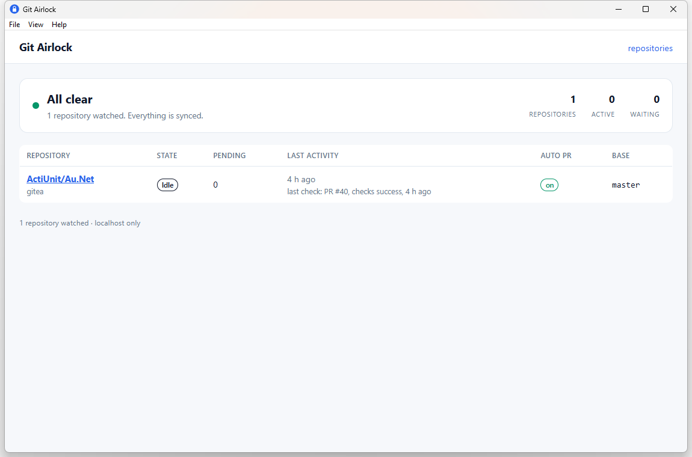
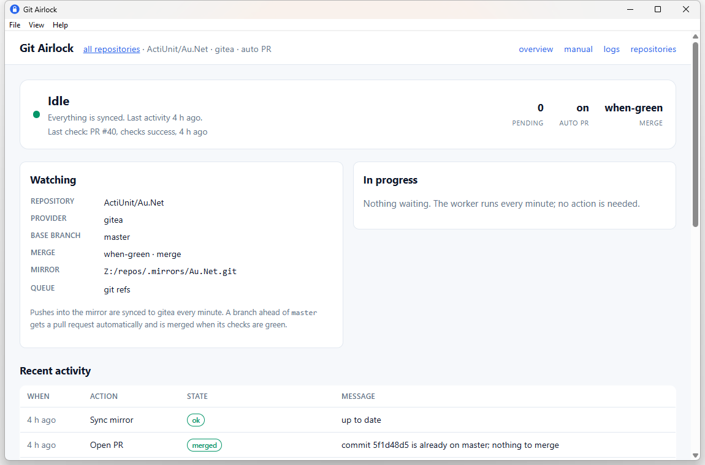
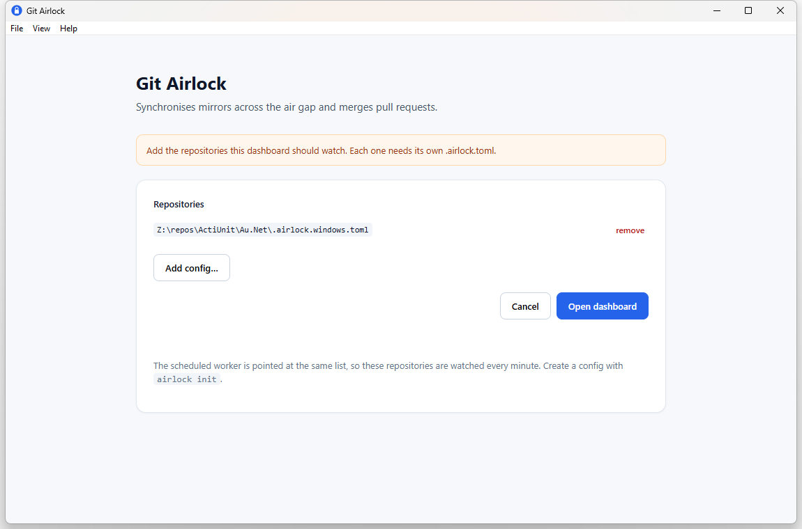

# Git Airlock

**Push commits and merge pull requests from a machine that cannot reach your private git remote.**

Git Airlock is a small CLI for a common split-brain setup: the code and the AI
agent live on one machine (home server, sandbox, air-gapped box), while the
private Git remote (Gitea, GitHub Enterprise, GitLab) is only reachable from a
VPN-connected workstation. You do **not** want to connect those networks.

Airlock lets the isolated machine keep working normally:

- it pushes to a **local bare mirror** on the LAN;
- PR actions are written to a **shared request queue**;
- a **worker on the trusted workstation** executes them against the real remote
  and writes the result back.

The isolated machine never talks to the private network, and the API token never
leaves the workstation.

```
 isolated machine (agent, sandbox)          trusted workstation (VPN)
 ─────────────────────────────────          ────────────────────────
 git push ──► bare mirror ────────────────► sync ──► private remote
 PR request ─► queue/requests ────────────► worker ─► Gitea / GitHub API
               queue/results ◄─────────────┘         (create, checks, merge)
```

Git Airlock is stable at **1.7**: the CLI, config format, queue refs and
dashboard are covered by tests and have been used in production since 0.9.
See [CHANGELOG.md](CHANGELOG.md) for the release history.

## Screenshots



The repository detail page and the picker:

| Repository | Repositories |
| --- | --- |
|  |  |

The desktop app is a native window (WebView2 on Windows); all buttons write to
the same queue as the CLI. The **Repositories** screen is also reachable from
the dashboard header and from the native menu.


## Why not just a VPN / tunnel?

Because that is exactly what you are trying to avoid. A VPN client, a reverse
SSH tunnel or a Cloudflare tunnel all create a network path from the isolated
machine to the private network, put credentials on that machine, and need an
inbound port or a long-lived connection. Airlock is **pull-based**: only the
trusted workstation reaches out, and only it holds the token.

## Install

Requires Go 1.22+.

```bash
go install github.com/erikibolya/git-airlock/cmd/airlock@latest
```

Prebuilt archives for Linux (amd64/arm64), macOS (amd64/arm64) and Windows
(amd64) are on the [Releases](https://github.com/erikibolya/git-airlock/releases)
page.

Package managers:

```bash
# macOS / Linux
brew tap erikibolya/git-airlock
brew install git-airlock
```

```powershell
# Windows (CLI; use the installer for the desktop app)
scoop bucket add git-airlock https://github.com/erikibolya/scoop-git-airlock
scoop install git-airlock/git-airlock
```

The winget manifest for `ErikIbolya.GitAirlock` is in
[microsoft/winget-pkgs#464029](https://github.com/microsoft/winget-pkgs/pull/464029)
(still in Microsoft review as of 1.7.4); once merged, install it with
`winget install ErikIbolya.GitAirlock`. The manifests are generated from
[`packaging/`](packaging).

Windows also has a one-click installer, `GitAirlockSetup-<version>.exe`. It
installs the CLI, the desktop dashboard, a Start-menu and desktop shortcut, and
an autostart entry that keeps the dashboard in the notification area. The
scheduled worker task is created during setup.

The desktop app updates itself. On startup and from **Help → Check for
updates…** it reads the signed `latest.json` from the latest release, verifies
the Ed25519 signature and the installer SHA256, and then downloads, silently
installs and restarts. `airlock-desktop --check-updates` runs the same check
headlessly. Package-manager installs upgrade through `brew`, `scoop` or
`winget`.

Or build from source:

```bash
git clone https://github.com/erikibolya/git-airlock
cd git-airlock
go build -o airlock ./cmd/airlock
```

## Quick start

### 1. On the isolated machine

From an existing checkout that still has the private remote configured as
`origin`:

```bash
cd /path/to/repo

airlock init \
  --provider gitea \
  --remote company \
  --configure-git
```

Use `--provider github` or `--provider gitlab` for other hosts.

`--configure-git` does three things:

1. creates a bare mirror (default `~/.airlock/<owner>-<name>.git`);
2. renames the private remote `origin` → `company`;
3. points `origin` at the bare mirror and records the private URL on the mirror.

From now on:

```bash
git push origin <branch>      # goes to the mirror, no VPN needed
airlock pr open               # queued; the workstation creates and merges it
```

### 2. On the workstation (VPN)

Set a token and run the worker once:

```bash
export GITEA_TOKEN=...        # GITLAB_TOKEN / GITHUB_TOKEN, or AIRLOCK_TOKEN
                              # GitHub can also use `gh auth token`
airlock worker --config /path/to/repo/.airlock.toml
airlock doctor --config /path/to/repo/.airlock.toml
```

Install the minute timer:

```bash
airlock install-task --config /path/to/repo/.airlock.toml
```

That creates a **Windows Task Scheduler** task, a **systemd user timer**, or a
**launchd agent**, depending on the OS. On Windows the task starts
`airlock-worker.exe`, a GUI-subsystem build that never creates a console window;
portable installs without that file fall back to `airlock.exe worker --hidden`.

> The worker must run where the mirror and queue paths resolve. In the common
> home-lab setup that is WSL/Linux next to the shared folder. Windows workers
> work too when the share is mounted at matching or configured paths.

## Commands

```text
airlock init                 create .airlock.toml, optional mirror/remotes
airlock sync                 fast-forward-only mirror <-> private remote
airlock pr open              create/reuse a PR and merge when checks pass
airlock pr open --merge never
airlock pr open --dry-run
airlock pr status <n>
airlock pr merge <n> --when-green
airlock worker               sync + process the queue once
airlock worker --loop 1m     run continuously
airlock status [--config ...]... [--watch]  terminal dashboard (TUI-lite)
airlock mcp                  stdio MCP server for agents
airlock ui [--config ...]...  local web dashboard (one or more repos)
airlock doctor               diagnose config, CA, token, VPN, scheduler
airlock install-task         register the periodic worker
airlock instructions         print an AGENTS.md snippet
airlock version              print the build version
```

`airlock pr` exit codes: `0` done, `1` failed, `3` still queued (the worker
keeps retrying; check the result file later instead of resubmitting).

### Terminal status

`airlock status` prints pending requests, recent results and a log tail.
`--watch` refreshes every two seconds (a TUI-lite for terminals); `--json`
prints the same data for scripts.

### Multiple repositories

`airlock worker`, `airlock install-task` and `airlock ui` accept `--config`
more than once. One scheduled task can drive several repositories, and the
dashboard shows them together.

The dashboard opens on a **repository list**: every configured repository with
its state, pending count, last activity, last check, auto-PR flag and base
branch. Click a repository for its detail page (the overview described below).
In the desktop app, **tray → Repositories…** opens a picker where configs can be
added or removed; the dashboard and the scheduled worker are updated to that
same list.

## Web dashboard

```bash
airlock ui --config /path/to/.airlock.toml
# or several:
airlock ui --config Z:/repos/Acme/A/.airlock.toml --config Z:/repos/Acme/B/.airlock.toml
# airlock ui: http://127.0.0.1:8787/
```

The dashboard opens on a **repository list** with the worker state (idle,
working, or waiting for CI), the repositories it watches, pending counts and
last activity. Click a repository for its **overview**: state with an activity
bar, mirror and base branch, requests in progress with their checks, and recent
activity. Pages refresh themselves every minute. Manual actions (open/check/
merge PR, immediate sync) live on a separate **manual** page, because automatic
pull requests handle normal work.
**logs** shows that repository's worker log (one file per mirror under the cache directory).

It never holds the API token and never calls the git host: buttons only write
requests to the queue, exactly like the CLI. (The manual *Sync now* button is the
exception; like `airlock sync`, it runs on the machine showing the dashboard.)

**Localhost vs LAN.** The default bind is `127.0.0.1:8787`, so only the computer
running the UI can open it. To view it from another device on your network:

```bash
airlock ui --listen 0.0.0.0:8787
# access token: <random token>
```

Airlock then requires that token; open the printed URL once and it is stored in
an HttpOnly cookie. Use this only on a network you trust — the dashboard can
enqueue merges, though the worker still waits for green checks. `--open` launches
the browser.

### MCP server

`airlock mcp` speaks the Model Context Protocol over stdio, so an agent can use
structured tools instead of shell commands. It only writes to the queue; the
worker still performs the sync and the provider calls:

```bash
airlock mcp --config /path/to/.airlock.toml
```

Tools: `airlock_status`, `airlock_sync`, `airlock_pr_open`, `airlock_pr_status`
and `airlock_pr_merge`. They return the queued request id and the latest result;
`wait_seconds` controls how long a call waits for the worker (default 55 s,
`0` returns immediately).

OpenCode configuration (`opencode.json`):

```json
{
  "$schema": "https://opencode.ai/config.json",
  "mcp": {
    "git-airlock": {
      "type": "local",
      "command": ["airlock", "mcp", "--config", "/path/to/.airlock.toml"],
      "enabled": true
    }
  }
}
```

Run it on the isolated machine (where the mirror and queue paths resolve), not
on the VPN-connected worker.

### Desktop app

`airlock-desktop.exe` is a native window around the same dashboard (WebView2 on
Windows, WebKitGTK on Linux, WKWebView on macOS): no browser tab, no local
server to keep running. It reads the same configs and queues as the CLI, adds a
notification-area icon with **Open dashboard**, **Repositories…**, **Sync now**
and **Quit**, a native **File / Help** menu (Dashboard, Repositories…, Manual,
Logs, Sync now, Quit, Check for updates…, GitHub, About), and hides to
the tray when you close the window. The tray menu also shows the latest worker
result (click it to open the dashboard) and the tooltip follows it; it refreshes
every 30 seconds. Merged or failed requests raise a native notification: a
Windows toast (the installer registers the AppUserModelID on the Start-menu
shortcut), `notify-send` on Linux, or the Notification Center on macOS. Use
`airlock-desktop.exe --notify-test` to check the setup. Windows "Do Not Disturb"
hides the banner but keeps it in the notification center. It never holds the API
token; the scheduled worker still performs the sync and the API calls.

```powershell
airlock-desktop.exe --config Z:\repos\Acme\Au.Net\.airlock.windows.toml
airlock-desktop.exe --config <a> --config <b>     # several repositories
airlock-desktop.exe --repos                       # open the repository picker
```

The list is remembered after the first launch. Without `--config` the app looks
for `.airlock.toml` in its working directory, so the installer drops the first
config next to the executable and the shortcuts need no arguments.
**Repositories…** (the first-run screen) adds or removes configs; **Open
dashboard** applies the list and points the scheduled worker at the same
repositories without a restart.

The desktop app is a separate Go module in [`desktop/`](desktop), built with
[Wails](https://wails.io) and Go 1.25+. The installer sources live in
[`installer/`](installer):

```powershell
# one-time
go install github.com/wailsapp/wails/v2/cmd/wails@latest
winget install -e --id JRSoftware.InnoSetup

# build the app, CLI and installer into installer/dist
pwsh -File installer/build.ps1

# use this machine's config as the default instead of the example template
pwsh -File installer/build.ps1 -Config Z:\repos\Acme\Au.Net\.airlock.windows.toml
```

On Linux, install `libgtk-3-dev libwebkit2gtk-4.1-dev` and run `wails build` in
`desktop/`. Release builds are produced on Windows so the executable gets its
icon and manifest.

## Configuration

`airlock init` writes `.airlock.toml` in the repository root:

```toml
repo     = "owner/name"
remote   = "company"                 # private remote name
mirror   = "~/.airlock/owner-name.git"
queue    = "~/.airlock/queue"        # shared dir, or "git" for refs/airlock/*
provider = "gitea"                   # gitea | github | gitlab
api      = "https://gitea.example.com/api/v1"
ca       = ""                        # optional PEM bundle
base     = "main"                    # default PR target
merge    = "when-green"              # never | when-green | now
merge_strategy = "merge"             # merge | squash | rebase
# mirror_remote = "ssh://user@host/path/repo.git"  # SSH-only worker
# remote_url    = "https://gitea.example.com/owner/name.git"
delete_branch = false                # delete the source branch after merge
auto_pr  = false                     # open PRs for branches ahead of base
auto_pr_ignore = ["wip/*"]           # optional branch globs to skip
```

The file contains no secrets; it can be committed if the paths are the same on
all machines. `AIRLOCK_CONFIG` points the CLI at another file.

### Tokens

Resolved in this order, never printed:

1. `AIRLOCK_TOKEN`
2. `GITEA_TOKEN` / `GITHUB_TOKEN`
3. `gh auth token` (GitHub only)
4. userinfo embedded in the private remote URL (Gitea convenience)

For a private CA, set `ca` to a PEM bundle.

### Queue transports

- `queue = "/path"` — a shared directory with `requests/`, `results/` and
  `processed/`. Simple and inspectable; both machines must mount it.
- `queue = "git"` — requests and results are blobs referenced from
  `refs/airlock/requests/*` and `refs/airlock/results/*` in the bare mirror.
  No second shared folder is needed; the queue lives in the mirror.
  Both sides still need access to the mirror (direct path or the same mount).
- `queue = "git"` plus `queue_remote = "ssh://..."` — the refs are pushed and
  fetched through a local cache, so the queue itself needs no shared folder.
  The `mirror` path is still the local clone used for the commit sync.

The git-ref transport is the right choice when the mirror is already shared but
you do not want another writable queue directory on the isolated machine.

## How the sync works

- `git fetch <remote>` into `refs/remotes/<remote>/*`.
- Every local branch is pushed **only if it fast-forwards the remote**.
- Every remote branch is fast-forwarded into the mirror **only if the mirror is
  behind**.
- Diverged branches are reported and left alone. Nothing is ever force-pushed.
- Tags are pushed non-forced.

That means the agent can push freely, and a human can still push from the
workstation; neither side silently destroys the other.

### Sync over SSH

When the workstation cannot mount the mirror at all, keep a local cache instead.
The isolated config stays unchanged; the worker config adds:

```toml
mirror = "~/.cache/git-airlock/mirrors/Au.Net.git"   # cache, created on first sync
mirror_remote = "ssh://erik@holly/mnt/user/Development/repos/.mirrors/Au.Net.git"
queue = "git"
queue_remote = "ssh://erik@holly/mnt/user/Development/repos/.mirrors/Au.Net.git"
remote_url = "https://gitea.example.com/ActiUnit/Au.Net.git"
```

The worker fetches both the SSH mirror and the private remote into the cache,
fast-forwards it, and pushes only fast-forwards back. Diverged branches are
reported and never force-pushed. `queue_remote` already carries the queue refs
over SSH, so no shared mount is needed at all. Keep credentials in an SSH key or
a git credential helper; avoid putting tokens in `remote_url`. If the cache
already has the private remote configured, `remote_url` can be omitted.

## How merging works

`pr open` (default `--merge when-green`):

1. find an open PR for `head -> base`, or create one;
2. read the PR's CI status;
3. merge only on `success`; `pending` leaves the request queued and the worker
   retries every minute; `failure` finalises the request with an error.

The merge method is `merge_strategy` (or `--strategy` on `pr open` and
`pr merge`): `merge`, `squash` or `rebase`. Gitea and GitHub support all three;
GitLab supports `merge` and `squash` (its API cannot merge after an asynchronous
rebase).

Set `delete_branch = true` (or pass `--delete-branch`) to remove the source
branch after a successful merge. A failed cleanup is reported in the result but
does not turn the merge into a failure.

For Gitea, only `(pull_request)` statuses gate the merge. Push runs get
cancelled by newer pushes and Gitea reports those as failures, so including them
would block every merge.

For GitHub, the worker combines check runs and commit statuses.

For GitLab, the latest pipeline for the PR head SHA gates the merge.

If a repository has no CI at all the request stays pending forever by design;
use `--merge never` or `--merge now` explicitly.

## Automatic pull requests

Set `auto_pr = true` and every worker run opens a PR for each local branch in the
mirror that is ahead of `base` and has no open PR yet. The branch tip's commit
subject becomes the title, and the PR merges according to `merge` (normally
`when-green`). Pushing a branch is then enough:

```bash
git push origin feature/login        # into the mirror, no VPN needed
# worker: opens feature/login -> main, waits for CI, merges
```

Rules:

- `base` itself is skipped, and `auto_pr_ignore = ["wip/*"]` skips patterns.
- A merged PR (including squash merges) or a PR you closed is not reopened for
  the same commit; new commits on the branch produce a fresh PR.
- An existing open PR is left to its creator, so `airlock pr open --merge never`
  keeps its merge mode.
- Auto-created requests show up in the dashboard and worker log like any other
  request, so you can still see exactly what was queued.

## Security model

- The isolated machine can push to the mirror and add requests. Nothing else.
- The API token is resolved on the trusted workstation; requests and results
  never contain it. (If your private remote URL embeds a git token, that URL
  lives in `.git/config` as before; use a credential helper if you want it out
  of the working copy.)
- The worker validates the action, branches and PR number; the API base and
  repository come from the config, not from the request.
- Requests are plain JSON files; the queue directory must be writable by both
  sides but readable only by trusted users.
- Merge happens only after green checks (`when-green`); `now` is an explicit
  human override.
- The workstation can veto a merge by closing the PR.

Airlock is not a sandbox. If the isolated machine is compromised, it can still
push malicious commits to the mirror and request PRs. Fast-forward-only sync and
CI gating limit the damage; review is still your job.

## Code signing policy

Free code signing provided by [SignPath.io](https://signpath.io/), certificate by
[SignPath Foundation](https://signpath.org/). **Status:** the project was
submitted to SignPath Foundation on 2026-10-29; Windows releases stay unsigned
until the application is approved.

This is a single-maintainer project, so one person holds every role:

| Role | Responsibility | Member |
| --- | --- | --- |
| Author | commits and merges to `main` | [Erik Ibolya](https://github.com/erikibolya) |
| Reviewer | reviews pull requests | Erik Ibolya |
| Approver | approves each signing request | Erik Ibolya |

Releases are built from this repository by GitHub Actions
([`.github/workflows/release.yml`](.github/workflows/release.yml)); only artifacts
produced by that workflow are submitted for signing. The build order, artifact
configuration and workflow steps are in
[docs/CODE_SIGNING.md](docs/CODE_SIGNING.md).

**Privacy:** Git Airlock has no telemetry and collects nothing. It connects only
to systems you configure: your Git provider (GitHub, GitLab or Gitea) to sync
branches and manage pull requests, optionally an SSH host for `queue_remote`,
and — from the Windows desktop app on every start — `github.com` to check for
updates. Set `AIRLOCK_UPDATE_URL` to check a different URL, or run a development
build (`main.version == "dev"`), to skip the update check.

## Antivirus false positives (Windows)

While releases are unsigned, Defender's ML heuristics occasionally quarantine the
Windows binaries as `Trojan:Win32/Bearfoos.B!ml`. In builds up to 1.7.2 the
scheduled task ran through `worker.vbs`, so the failure appeared as a Windows
Script Host dialog (`0x800700E1`, then `0x80070002` once the executable was
quarantined). 1.7.3+ starts `airlock.exe worker --hidden` directly; a blocked
worker is then only visible in Task Scheduler. This is a false positive: verify
the installer against the published SHA256 and the Ed25519 signature in
`latest.json`, then follow
[docs/CODE_SIGNING.md](docs/CODE_SIGNING.md#defender-false-positives) to restore
the file or add an exclusion.

## Scheduling

| OS | Mechanism | Notes |
| --- | --- | --- |
| Windows | Task Scheduler | interactive user task, runs every minute; the worker hides its own console |
| Linux | systemd user timer | one-shot `airlock worker` |
| macOS | launchd agent | `StartInterval` |

`airlock install-task --print` shows the generated files without touching your
system.

## Limitations / roadmap

- The worker polls every minute; it is not an event-driven service.
- Gitea, GitHub and GitLab are supported today. There is no review automation,
  labels or approval policy yet.
- The web dashboard is loopback-first; LAN exposure requires an access token.
- The desktop app is packaged as a Windows installer only; Linux/macOS builds
  work but are not packaged. The CLI and the queue remain the source of truth;
  the UIs are conveniences.
- Automatic updates run on Windows only. Homebrew, Scoop and winget users
  upgrade through their package manager.
- Windows binaries are not Authenticode-signed while the SignPath Foundation
  application is pending, so SmartScreen and occasional Defender ML heuristics
  may warn about them. The updater still verifies the Ed25519 signature and
  SHA256 of every download. See
  [Code signing policy](#code-signing-policy).
- See [ROADMAP.md](ROADMAP.md) for labels, code signing and Linux packages.

## Development

```bash
go vet ./...
go test ./...
go build ./cmd/airlock
```

The desktop app is its own module:

```bash
cd desktop
go vet ./...
go build ./...
```

The tests cover both queue transports, fast-forward sync (including divergence),
all three provider adapters, and the worker's pending/merge state machine.

[AGENTS.md](AGENTS.md) is the working guide for coding agents (repo map,
environment, gotchas) and [docs/RELEASING.md](docs/RELEASING.md) is the release
checklist, including the update-signing key.

The end-to-end test in [`test/integration`](test/integration) starts Gitea and a
real `act_runner` in Docker, pushes from the isolated side, runs the real
worker, waits for the workflow's commit status and checks the squash merge plus
branch cleanup:

```bash
bash test/integration/run.sh
```

## License

MIT
